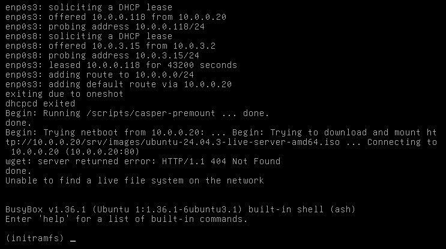
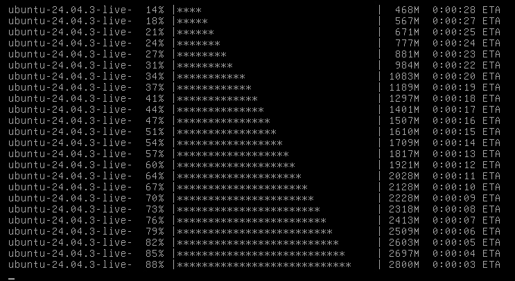
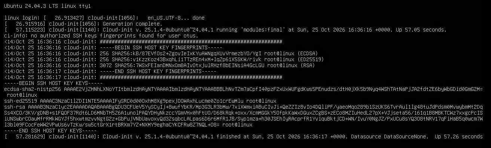
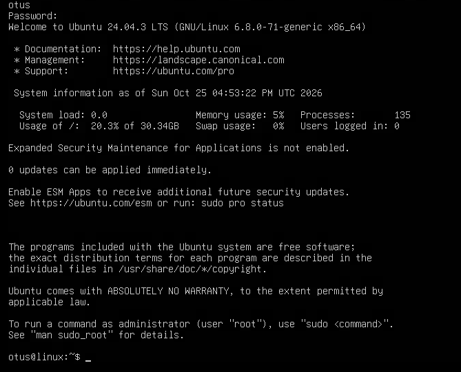
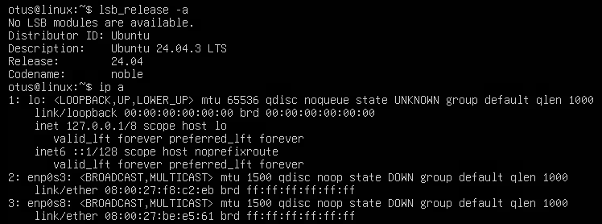

# Отчёт по домашнему заданию по практике с PXE (14.10)

- **Автор:** Павлов Сергей
- **Дата выполнения:** 25.10.2026
- **Задание:** 
  - Настроить заргузку по сети дистрибутива Ubuntu24;
  - Установка должна проходить из HTTP-репозитория;
  - Настроить автоматическую установку с помощью файла user-data.

---

## Исходное состояние

- VMWare ESXI
- Хостовая ОС: Ubuntu 24.04.1 LTS

---

## Ход работы
Структура проекта:
pxe-homework:
  - Vagrantfile
  - ansible:
    - provision.yml
    - hosts
    - templates:
      - pxe.conf.j2
      - ks-server.conf.j2
      - pxelinux-default.j2
      - user-data.j2
  - README.md

## Заметки
- Таймаут `vagrant up`: команда `vagrant up` завершится ошибкой таймаута SSH на `pxeclient`. Это штатное состояние: клиент загружается по сети и не имеет SSH-сервера, пока установка не завершится. Установка идет в фоне.
- Ручное переключение загрузки: После завершения установки необходимо вручную выключить `pxeclient` и переключить порядок загрузки с сети на диск, чтобы машина загрузилась с установленной ОС:
  ```
  VBoxManage controlvm "имя_ВМ" poweroff
  VBoxManage modifyvm "имя_ВМ" --boot1 disk
  VBoxManage startvm "имя_ВМ" --type headless
  ```

### 1. Подготовка структуры и необходимых файлов
Создание директорий:
```
zenhert@linpro:~$ mkdir -p ~/pxe-homework/ansible/templates
zenhert@linpro:~$ cd ~/pxe-homework
```

Создание `Vagrantfile`:
```
zenhert@linpro:~/pxe-homework$ nano Vagrantfile
zenhert@linpro:~/pxe-homework$ cat Vagrantfile
Vagrant.configure("2") do |config|
  config.vm.define "pxeserver" do |server|
    server.vm.box = "ubuntu2404"
    server.vm.host_name = "pxeserver"
    server.vm.network "forwarded_port", guest: 80, host: 8080
    server.vm.network :private_network,
                      ip: "10.0.0.20",
                      virtualbox__intnet: "pxenet"
    server.vm.network :private_network, ip: "192.168.50.10", adapter: 3
    server.vm.provider "virtualbox" do |vb|
      vb.memory = "2048"
      vb.cpus = 1
      vb.customize ["modifyvm", :id, "--natdnshostresolver1", "on"]
    end
    server.vm.provision "ansible" do |ansible|
      ansible.playbook = "ansible/provision.yml"
      ansible.inventory_path = "ansible/hosts"
      ansible.host_key_checking = false
      ansible.limit = "all"
    end
  end

  config.vm.define "pxeclient" do |pxeclient|
    pxeclient.vm.box = "ubuntu2404"
    pxeclient.vm.host_name = "pxeclient"
    pxeclient.vm.provider :virtualbox do |vb|
      vb.memory = "4096"
      vb.cpus = 2
      vb.customize ["modifyvm", :id, "--natdnshostresolver1", "on"]
      vb.customize [
        "modifyvm", :id,
        "--nic1", "intnet",
        "--intnet1", "pxenet",
        "--nic2", "nat",
        "--boot1", "net",
        "--boot2", "none",
        "--boot3", "none",
        "--boot4", "none"
      ]
    end
  end
end
```

Создание `ansible/hosts`:
```
zenhert@linpro:~/pxe-homework$ nano ansible/hosts
zenhert@linpro:~/pxe-homework$ cat ansible/hosts
[pxeserver]
pxeserver ansible_host=192.168.50.10 ansible_user=vagrant ansible_ssh_private_key_file=.vagrant/machines/pxeserver/virtualbox/private_key

[all:vars]
ansible_python_interpreter=/usr/bin/python3
```

Создание `ansible/provision.yml`:
``` 
zenhert@linpro:~/pxe-homework$ nano ansible/provision.yml
zenhert@linpro:~/pxe-homework$ cat ansible/provision.yml
---
- name: Configure PXE server
  hosts: pxeserver
  become: true
  vars:
    pxe_ip: "10.0.0.20"
    netboot_url: "https://releases.ubuntu.com/24.04/ubuntu-24.04.3-netboot-amd64.tar.gz"
    iso_url: "https://releases.ubuntu.com/24.04/ubuntu-24.04.3-live-server-amd64.iso"

  tasks:
    - name: Disable ufw
      systemd:
        name: ufw
        state: stopped
        enabled: false

    - name: Install dnsmasq and apache2
      apt:
        name:
          - dnsmasq
          - apache2
        state: present
        update_cache: true

    - name: Detect PXE interface name by IP
      shell: "ip -o -4 addr show | awk '$4 ~ /^{{ pxe_ip }}\\// {print $2}'"
      register: pxe_iface
      changed_when: false

    - name: Fail if PXE interface not found
      fail:
        msg: "Interface with IP {{ pxe_ip }} not found"
      when: pxe_iface.stdout == ""

    - name: Show detected interface
      debug:
        msg: "PXE interface: {{ pxe_iface.stdout }}"

    - name: Deploy dnsmasq PXE config
      template:
        src: templates/pxe.conf.j2
        dest: /etc/dnsmasq.d/pxe.conf
        owner: root
        group: root
        mode: '0644'
      notify: restart dnsmasq

    - name: Ensure /srv/tftp exists
      file:
        path: /srv/tftp
        state: directory
        mode: '0755'

    - name: Download Ubuntu netboot archive
      get_url:
        url: "{{ netboot_url }}"
        dest: /tmp/noble-netboot-amd64.tar.gz
        timeout: 600

    - name: Extract netboot archive
      unarchive:
        src: /tmp/noble-netboot-amd64.tar.gz
        dest: /srv/tftp
        remote_src: true

    - name: Flatten netboot directory structure
      shell: |
        if [ -d /srv/tftp/amd64/amd64 ]; then
          mv /srv/tftp/amd64/amd64/* /srv/tftp/amd64/
          rmdir /srv/tftp/amd64/amd64
        fi
      args:
        creates: /srv/tftp/amd64/pxelinux.0

    - name: Ensure pxelinux.cfg directory exists
      file:
        path: /srv/tftp/amd64/pxelinux.cfg
        state: directory
        mode: '0755'

    - name: Ensure /srv/images exists
      file:
        path: /srv/images
        state: directory
        mode: '0755'

    - name: Download Ubuntu 24.04 server ISO
      get_url:
        url: "{{ iso_url }}"
        dest: /srv/images/ubuntu-24.04.3-live-server-amd64.iso
        timeout: 1800

    - name: Ensure /srv/ks exists
      file:
        path: /srv/ks
        state: directory
        mode: '0755'

    - name: Deploy user-data for autoinstall
      template:
        src: templates/user-data.j2
        dest: /srv/ks/user-data
        owner: root
        group: root
        mode: '0644'

    - name: Create empty meta-data
      copy:
        content: ""
        dest: /srv/ks/meta-data
        owner: root
        group: root
        mode: '0644'

    - name: Deploy pxelinux.cfg/default
      template:
        src: templates/pxelinux-default.j2
        dest: /srv/tftp/amd64/pxelinux.cfg/default
        owner: root
        group: root
        mode: '0644'

    - name: Deploy apache vhost for ks and images
      template:
        src: templates/ks-server.conf.j2
        dest: /etc/apache2/sites-available/ks-server.conf
        owner: root
        group: root
        mode: '0644'

    - name: Enable ks-server site
      command: a2ensite ks-server.conf
      args:
        creates: /etc/apache2/sites-enabled/ks-server.conf

    - name: Disable default apache site
      command: a2dissite 000-default.conf
      args:
        removes: /etc/apache2/sites-enabled/000-default.conf

    - name: Restart apache2
      systemd:
        name: apache2
        state: restarted
        enabled: true

  handlers:
    - name: restart dnsmasq
      systemd:
        name: dnsmasq
        state: restarted
        enabled: true
```

Создание шаблонов:
```
zenhert@linpro:~/pxe-homework$ nano ansible/templates/pxe.conf.j2
zenhert@linpro:~/pxe-homework$ cat ansible/templates/pxe.conf.j2
interface={{ pxe_iface.stdout }}
bind-interfaces
dhcp-range={{ pxe_iface.stdout }},10.0.0.100,10.0.0.120,12h
dhcp-boot=pxelinux.0
dhcp-match=set:efi-x86_64,option:client-arch,7
dhcp-boot=tag:efi-x86_64,bootx64.efi
enable-tftp
tftp-root=/srv/tftp/amd64
```
```
zenhert@linpro:~/pxe-homework$ nano ansible/templates/pxe.conf.j2
zenhert@linpro:~/pxe-homework$ cat ansible/templates/pxe.conf.j2
interface={{ pxe_iface.stdout }}
bind-interfaces
dhcp-range={{ pxe_iface.stdout }},10.0.0.100,10.0.0.120,12h
dhcp-boot=pxelinux.0
dhcp-match=set:efi-x86_64,option:client-arch,7
dhcp-boot=tag:efi-x86_64,bootx64.efi
enable-tftp
tftp-root=/srv/tftp/amd64
zenhert@linpro:~/pxe-homework$ ^C
zenhert@linpro:~/pxe-homework$ nano ansible/templates/ks-server.conf.j2
zenhert@linpro:~/pxe-homework$ cat ansible/templates/ks-server.conf.j2
<VirtualHost {{ pxe_ip }}:80>
    DocumentRoot /

    <Directory /srv/images>
        Options Indexes MultiViews
        AllowOverride All
        Require all granted
    </Directory>

    <Directory /srv/ks>
        Options Indexes MultiViews
        AllowOverride All
        Require all granted
    </Directory>
</VirtualHost>
```
```
zenhert@linpro:~/pxe-homework$ nano ansible/templates/pxelinux-default.j2
zenhert@linpro:~/pxe-homework$ cat ansible/templates/pxelinux-default.j2
DEFAULT install
LABEL install
    KERNEL linux
    INITRD initrd
    APPEND root=/dev/ram0 ramdisk_size=3000000 ip=dhcp iso-url=http://{{ pxe_ip }}/srv/images/ubuntu-24.04.3-live-server-amd64.iso autoinstall ds=nocloud-net;s=http://{{ pxe_ip }}/srv/ks/
```
```
zenhert@linpro:~/pxe-homework$ nano ansible/templates/ks-server.conf.j2
zenhert@linpro:~/pxe-homework$ cat ansible/templates/ks-server.conf.j2
<VirtualHost {{ pxe_ip }}:80>
    DocumentRoot /

    <Directory /srv/images>
        Options Indexes MultiViews
        AllowOverride All
        Require all granted
    </Directory>

    <Directory /srv/ks>
        Options Indexes MultiViews
        AllowOverride All
        Require all granted
    </Directory>
</VirtualHost>
zenhert@linpro:~/pxe-homework$ ^C
zenhert@linpro:~/pxe-homework$ nano ansible/templates/pxelinux-default.j2
zenhert@linpro:~/pxe-homework$ cat ansible/templates/pxelinux-default.j2
DEFAULT install
LABEL install
    KERNEL linux
    INITRD initrd
    APPEND root=/dev/ram0 ramdisk_size=3000000 ip=dhcp iso-url=http://{{ pxe_ip }}/srv/images/noble-live-server-amd64.iso autoinstall ds=nocloud-net;s=http://{{ pxe_ip }}/srv/ks/
zenhert@linpro:~/pxe-homework$ ^C
zenhert@linpro:~/pxe-homework$ nano ansible/templates/user-data.j2
zenhert@linpro:~/pxe-homework$ cat ansible/templates/user-data.j2
#cloud-config
autoinstall:
  version: 1
  locale: en_US.UTF-8
  keyboard:
    layout: us
  identity:
    hostname: linux
    username: otus
    password: "$6$sJgo6Hg5zXBwkkI8$btrEoWAb5FxKhajagWR49XM4EAOfO/Dr5bMrLOkGe3KkMYdsh7T3MU5mYwY2TIMJpVKckAwnZFs2ltUJ1abOZ."
  ssh:
    install-server: true
    allow-pw: true
    authorized-keys: []
  network:
    version: 2
    ethernets:
      eth0:
        dhcp4: true
      eth1:
        dhcp4: true
  apt:
    geoip: true
    preserve_sources_list: false
    primary:
      - arches: [amd64, i386]
        uri: "http://archive.ubuntu.com/ubuntu"
      - arches: [default]
        uri: "http://ports.ubuntu.com/ubuntu-ports"
  drivers:
    install: false
  kernel:
    package: linux-generic
  updates: security
```

### 2. Запуск стенда и проверка
Запуск стенда:
```
zenhert@linpro:~/pxe-homework$ vagrant up
Bringing machine 'pxeserver' up with 'virtualbox' provider...
Bringing machine 'pxeclient' up with 'virtualbox' provider...
zenhert@linpro:~/pxe-homework$ vagrant status
Current machine states:
pxeserver                 running (virtualbox)
pxeclient                 running (virtualbox)
```

Проверка на `pxeserver`:
```
zenhert@linpro:~/pxe-homework$ vagrant ssh pxeserver
vagrant@pxeserver:~$ sudo -i
root@pxeserver:~# ss -tulpn | grep -E ':(67|69)'
udp   UNCONN 0      0                         0.0.0.0%eth1:67        0.0.0.0:*    users:(("dnsmasq",pid=3942,fd=4))
udp   UNCONN 0      0                            127.0.0.1:69        0.0.0.0:*    users:(("dnsmasq",pid=3942,fd=11))
udp   UNCONN 0      0                            10.0.0.20:69        0.0.0.0:*    users:(("dnsmasq",pid=3942,fd=8))
udp   UNCONN 0      0                                [::1]:69           [::]:*    users:(("dnsmasq",pid=3942,fd=17))
udp   UNCONN 0      0      [fe80::a00:27ff:fee2:aa43]%eth1:69           [::]:*    users:(("dnsmasq",pid=3942,fd=14))
root@pxeserver:~# curl -I http://10.0.0.20/srv/images/noble-live-server-amd64.iso
HTTP/1.1 200 OK
root@pxeserver:~# curl -I http://10.0.0.20/srv/ks/user-data
HTTP/1.1 200 OK
root@pxeserver:~# cat /srv/tftp/amd64/pxelinux.cfg/default
DEFAULT install
LABEL install
    KERNEL linux
    INITRD initrd
    APPEND root=/dev/ram0 ramdisk_size=3000000 ip=dhcp iso-url=http://10.0.0.20/srv/images/ubuntu-24.04.3-live-server-amd64.iso autoinstall ds=nocloud-net;s=http://10.0.0.20/srv/ks/
root@pxeserver:~# journalctl -u dnsmasq -f
Oct 25 15:49:45 pxeserver systemd[1]: Started dnsmasq.service - dnsmasq - A lightweight DHCP and caching DNS server.
Oct 25 15:50:06 pxeserver dnsmasq-dhcp[3942]: DHCPDISCOVER(eth1) 08:00:27:f8:c2:eb
Oct 25 15:50:06 pxeserver dnsmasq-dhcp[3942]: DHCPOFFER(eth1) 10.0.0.118 08:00:27:f8:c2:eb
Oct 25 15:50:06 pxeserver dnsmasq-dhcp[3942]: DHCPDISCOVER(eth1) 08:00:27:f8:c2:eb
Oct 25 15:50:06 pxeserver dnsmasq-dhcp[3942]: DHCPOFFER(eth1) 10.0.0.118 08:00:27:f8:c2:eb
Oct 25 15:50:09 pxeserver dnsmasq-dhcp[3942]: DHCPREQUEST(eth1) 10.0.0.118 08:00:27:f8:c2:eb
Oct 25 15:50:09 pxeserver dnsmasq-dhcp[3942]: DHCPACK(eth1) 10.0.0.118 08:00:27:f8:c2:eb
```
Как результат: `dnsmaqs` слушает 67/69 порты, `apache` отдает ISO и user-data, содержимое `pxelinux.cfg` нормальное, логи `dnsmasq` при загрузке клиента тоже в порядке и успешно запросил `DHCP`.

Проверка на `pxeclient`:
- 
- 
- 
- 
- 

Автоустановка прошла успешно